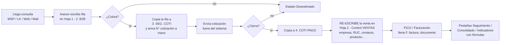
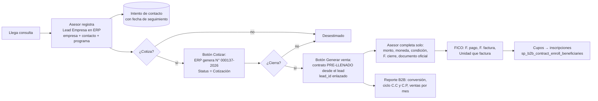

# Plan: Consultas y Ventas B2B dentro del ERP

> Análisis del 26/10/2026. Fuentes leídas en modo solo lectura:
> - **Hoja 1 – Registro de consultas:** libro `9. B2B`, pestaña `2. B2B` (gid 760210589), más `1. Ficha de Datos`, `4. Leyenda`, `3. SEG. COTI` y `4. COTI PAGO`.
> - **Hoja 2 – Control de ventas:** libro `B2_REG_CVWFB1.00 | CONTROL DE VENTAS: WE FOR BUSINESS`, pestaña `1. Control VENTAS` (gid 1399172502), más `Convenios`, `DON/AUS`, `Seguimiento`, `Clientes B2B`, `Base`, `BASE 2`, `Consolidado` y `LISTAS`.
> - **ERP:** módulos `b2b` (Leads Empresas, Empresas, Contratos) y `fico`, tablas `leads`, `lead_contact_attempts`, `companies`, `company_contacts` y `b2b_contracts`, y la BD local de pruebas.

---

## 1. Resumen

El proceso B2B vive hoy en **dos Google Sheets que se llenan a mano**:

1. **Consultas (Hoja 1):** 2,050 filas desde 2022. Hay una fila por cada producto consultado por una empresa. Lleva el estado de la consulta (Consulta → Cotización → Pagó / Desestimado), la cotización enviada y los datos del contacto.
2. **Ventas (Hoja 2):** 576 ventas desde 2022. Cuando la consulta se cierra, se **vuelve a escribir** la venta en otro libro con la plata, las fechas de cierre y pago, el documento oficial y la factura.

El ERP **ya tiene casi todo el modelo**: `leads` con `company_id` (lead de empresa), `lead_contact_attempts`, `companies`, `company_contacts` y `b2b_contracts`, que ya tiene `lead_id`, `consultation_date`, `close_date`, `payment_date`, `confirmation_sent_date` e `invoice_date`. Los dos sheets no necesitan un módulo nuevo; lo que falta es **completar el formulario, unificar los catálogos y conectar la consulta con la venta**.

**Los 3 hallazgos que mandan:**

| # | Hallazgo | Impacto |
|---|---|---|
| H1 | **Doble digitación:** empresa, RUC, contacto, celular, correo, producto y modalidad se escriben en la Hoja 1 y otra vez en la Hoja 2. | 7 campos x 576 ventas escritos dos veces, con errores de tipeo entre hojas. |
| H2 | **La consulta y la venta no están unidas.** En el ERP, los 310 contratos migrados del sheet tienen `lead_id` vacío (0 de 310). | No se puede medir la conversión consulta → venta ni el tiempo de cierre por asesor o canal. |
| H3 | **El producto es texto libre.** Solo 67 de los 539 productos distintos de la Hoja 1 calzan con la `abbreviation` de un programa del ERP: el 32% de las filas. En la Hoja 2 calzan 53 de 229, el 38% de las filas. | Los reportes por programa salen incompletos. En el TO-BE, el producto se elige de un catálogo. |

> Sobre "los leads del módulo fico": `fico` **no registra leads**, solo los lee (estado, fecha de pago, contacto) para las inscripciones. El hogar natural de la Hoja 1 es **B2B > Leads Empresas** (`sp_company_lead_register`), y el de la Hoja 2 es **B2B > Contratos** (`sp_b2b_contract_register`). FICO entra después, cuando el contrato manda sus cupos a inscripción (`sp_b2b_contract_enroll_beneficiaries`).

---

## 2. Diagnóstico de renombramientos – Hoja 1 (Registro de consultas)

**Problemas de la cabecera actual:**
- La numeración está rota: `12.` aparece dos veces, el `11.` va después del `12.` y hay dos `14.`.
- Hay nombres que no dicen lo que guardan:
  - `2. UN` guarda la **plataforma** (TEAMS/ZOOM), no la unidad de negocio.
  - `5. MODALIDAD` guarda el **tipo de trato** (InHouse, Corporativo, Convenio), no la modalidad.
- Hay columnas que son **fórmulas o copias** (`12. TEXT RUC`, `MASIVO`, `N INFORME`, `COD- INFORME`).

| # | Cabecera actual | Qué guarda realmente | Nombre sugerido (acorde al ERP) | Campo ERP | Acción |
|---|---|---|---|---|---|
| 1 | `1. FECHA ` | Fecha de la consulta | **F. Consulta** | `leads.first_contact_date` (y `registration_date`) | Renombrar |
| 2 | `2. UN` | Plataforma o modalidad de dictado: TEAMS 945, ZOOM 494, PRESENCIAL 383, ONLINE 38, HÍBRIDO 18, OTRO 10, BLENDED 3 | **Modalidad** | `leads.cat_program_modality` (En Vivo / Online / Presencial) | Renombrar y mapear (§2.1) |
| 3 | `3. CAT` | Tipo de programa (CUR, DIPLO, ESP, PEE, TALLER, EVENTOS…) | **Tipo de programa** | `leads.cat_program_type` | Renombrar y mapear (§2.1) |
| 4 | `4. PROD` | Abreviatura del programa, en texto libre | **Programa** | `leads.program_version_id` (por `program_versions.abbreviation`) | Renombrar. En el ERP es un select (H3) |
| 5 | `5. MODALIDAD` | Tipo de trato: InHouse 1,111, Corporativo 529, Otros 187, Convenios 60… | **Tipo de trato** | `cat_contract_type`, el campo "Intención de negocio / tipo de trato" del form de Leads Empresas | Renombrar (es el error de nombre más grave) |
| 6 | `6. NOM` | Nombre del contacto | **Contacto** | `leads.full_name` y `company_contacts.name` | Renombrar |
| 7 | `7. CORREO` | Correo del contacto | **Correo contacto** | `leads.origin_email` y `company_contacts.email` | Renombrar. **Falta en el form del ERP** |
| 8 | `8.CELULAR` | Celular del contacto | **Celular contacto** | `leads.origin_phone` y `company_contacts.phone` | Renombrar. **Falta en el form del ERP** |
| 9 | `9.EMPRESA` | Razón social | **Empresa** | `leads.company_id` → `companies.razon_social` | Renombrar |
| 10 | `10.RUCNIT` | RUC / NIT | **RUC / Nro. documento** | `companies.document_number` | Renombrar |
| 11 | `12. TEXT RUC` | Copia del RUC como texto (fórmula) | — | — | **Eliminar.** La empresa ya trae su RUC |
| 12 | `11. ESTADO` | Estado de la consulta | **Status** | `leads.cat_status_lead` | Renombrar y mapear (§2.1) |
| 13 | `12. FECHA DE ESTADO` | Fecha del último cambio de estado | **F. Estado** | No hay columna. Se deriva del historial | Derivar (auditoría del lead) |
| 14 | `13. FECHA ENVIO COTIZ` | Fecha en que se envió la cotización | **F. Envío cotización** | **No existe** | Agregar (§5, ADR-2) |
| 15–23 | `Dia Contacto` / `Hora Contacto` / `Respuesta` (x3) | Intentos de contacto (1 fila llena de 2,050) | **Intentos de contacto** | `lead_contact_attempts` (fecha/hora, resultado, respuesta) | Ya existe en el ERP (sección de intentos del form) |
| 24 | `14. CANAL PROS.` | Canal de prospección | **Canal** | `leads.cat_channel` | Renombrar y mapear |
| 25 | `14. MEDIO LL.` | Medio de llegada | **Medio** | `leads.cat_medium_contact` | Renombrar y mapear |
| 26 | `15. PALABRA MKT` | Palabra clave del mensaje inicial | **Keyword MKT** | `leads.cat_frecuency_word` | Renombrar (valores ya calzan) |
| 27 | `16. TEXTO PROD.` | Si el producto iba en negrita (N / S/N) | — | — | **Eliminar.** Es formato, no dato |
| 28 | `17. ESTRAT` | Estrategia comercial | **Estrategia** | `leads.cat_type_strategy` | Renombrar (Masivos y Mailing existen; falta "RR B2C") |
| 29 | `18. AS` | Asesor o área que atiende (Arleth, Nataly, MKT, B2B, Académica…) | **Asesor** | `leads.user_registration_id` (usuario) | Renombrar. MKT, B2B y Académica son **áreas**, no personas |
| 30 | `19. ORDEN POR FECHA DE PAGO` | Correlativo de ventas por fecha de pago | — | Se calcula | **Eliminar** (es un reporte) |
| 31 | `20. OBS` | Observaciones | **Observaciones** | `leads.observations` | Renombrar |
| 32 | `FECHA DE PAGO` | Fecha de pago | **F. Pago** | `leads.pay_date` | Renombrar |
| 33 | `CONTADOR` | Correlativo de la cotización (136, 98A…) | — | Parte del código | Se fusiona en **N° Cotización** |
| 34 | `COD-COTIZADOR` | Código de cotización `N° 000136 - 2023` | **N° Cotización** | **No existe** | Agregar, generado por el ERP (§5) |
| 35 | `NIVEL DE INTERES` | Bajo / Medio / Alto | **Nivel de interés** | `leads.cat_interest_level` | Renombrar (valores calzan) |
| 36 | `FECHA SEGUIMIENTO` | Próximo seguimiento | **Próximo seguimiento** | `lead_contact_attempts` con resultado *Pendiente* | Usar el intento programado |
| 37 | `N INFORME` | Copia de `CONTADOR` | — | — | **Eliminar** |
| 38 | `COD- INFORME` | Copia de `COD-COTIZADOR` | — | — | **Eliminar** (ver pregunta P3) |
| 39 | `FECHA ENVIO INFORME` | Fecha de envío del informe (91 filas) | **F. Envío informe** | **No existe** | Decidir (P3) |
| 40 | `NOMBRE (-)` | Vacía | — | — | **Eliminar** |
| 41 | `MASIVO` | Fórmula `,51<celular>` para envíos masivos | — | Se genera al exportar | **Eliminar** |

**En la Hoja 1 resultan:**
- 7 columnas que se eliminan (fórmulas, copias o formato), más `CONTADOR`, que se fusiona con el N° de cotización.
- 3 datos que no existen en el ERP: la fecha de envío de la cotización, el N° de cotización y el informe (este último está por decidir).
- Los 9 campos de intentos de contacto, que pasan a `lead_contact_attempts`.
- El resto son renombres hacia campos que ya existen.

### 2.1 Mapeo de valores de catálogo (sheet → ERP)

**Status (`11. ESTADO` → `cat_status_lead`)**

| Sheet | Filas | ERP | Nota |
|---|---|---|---|
| Desestimado | 1,010 | Desestimado | = |
| Pagó | 541 | Pagó | = |
| Consulta | 248 | **Atendido** | D1: o se crea un estado "Consulta" |
| Cotización | 101 | **Cotización (nuevo)** | Es una etapa real con pestaña propia (`3. SEG. COTI`) |
| Próximo Inicio | 36 | Prox. Inicio | = |
| Cerrado | 23 | Cerrado | = |
| Visto | 2 | Atendido | |
| Interesado | 1 | Interesado | = |
| Reserva | 1 | Pagará | |

**Canal (`14. CANAL PROS.`)**: LK → LinkedIn · FB → Facebook · WEB → WEB · EMAIL → **Mailing (nuevo en el catálogo de canal)** · `-` → `-`.

**Medio (`14. MEDIO LL.`)**: WSP → WhatsApp · LK → MSG · Mail → **Mail (nuevo)** · Call → **Llamada (nuevo)**. La Ficha de Datos ya define "Llamada" y "Mailing" como canales, pero el ERP no los tiene.

**Modalidad (`2. UN`)**: TEAMS / ZOOM → En Vivo · ONLINE → Online · PRESENCIAL → Presencial · HÍBRIDO / BLENDED → **D2** (crear "Híbrido" o asignar Presencial) · OTRO → vacío. La plataforma (Teams o Zoom) se pierde; si importa, va en la edición, no en el lead.

**Tipo de trato (`5. MODALIDAD` → `cat_contract_type`)**: Programas InHouse → IN HOUSE · Corporativo B2B → TRATO CORPORATIVO · Convenios Corporativos → CONVENIO · AUSPICIO → AUSPICIO · Otros → OTROS · Consultoría, Auditoría y Membresía Online → **D3** (crear CONSULTORÍA o dejar OTROS).

**Tipo de programa (`3. CAT` → `cat_program_type`)**: CUR y CUR O → Curso · DIPLO → Diplomado · ESP y ESP O → Especialización · PEE → PEE · MEMBRESIA → Membresía · EVENTOS → Congreso / Evento · TALLER (267) → **D4** (crear "Taller") · CONSULTORÍA, AUDITORÍA, LICENCIAS y OTROS → sin tipo de programa, porque no son programas académicos: se distinguen por el tipo de trato. La "O" de `CUR O` y `ESP O` es la modalidad Online metida en la categoría: se separa.

---

## 3. Diagnóstico de renombramientos – Hoja 2 (Control de ventas)

El ERP ya tiene el destino: **B2B > Contratos** (`b2b_contracts`), y su formulario usa casi los mismos rótulos (F. consulta, F. cierre, F. pago, F. confirmación, F. factura).

| Cabecera actual | Campo ERP | Acción |
|---|---|---|
| `FECHA` | `registration_date` | Lo pone el ERP |
| `MODALIDAD` | `cat_modality` | Mismo mapeo que `2. UN` (§2.1) |
| `EMPRESA`, `RUC` | `company_id` → `companies` | **Viene del lead** (H1) |
| `NOM. CONTACTO`, `CELULAR`, `CORREO` | `company_contacts` | **Viene del lead** (H1) |
| `NOMBRE P.` | `program_version_id` ("Programa vendido") | **Viene del lead**. Select, no texto (H3) |
| `PROGRAMA` (CORPORATIVO / INHOUSE / …) | `cat_contract_type` | Renombrar a **Tipo de trato**. **Viene del lead** |
| `TIPO DE CLIENTE` | `cat_client_type` (B2B NACIONAL / INTERNACIONAL / ESTADO) | = |
| `F. INICIO P.` | `start_date` | Renombrar a **F. inicio** |
| `SECTOR`, `CLASIFICACIÓN DE EMPRESA` | `companies.cat_sector`, `companies.cat_classification` | Es dato de la empresa, no de la venta: se elimina de la venta |
| `N° PARTI.` | `number_of_licenses` ("Cupos comprados") | Renombrar a **Cupos** |
| `T. MONEDA` | `cat_currency` | = |
| `SOLES` / `DÓLARES` | `total_amount` (más la moneda) | Se fusionan en **Monto total** |
| `CUOTA` (TOTAL / CRÉDITO / CUOTAS) | `cat_payment_terms` ("Condición de pago") | Renombrar |
| `F. CONSULTA` | `consultation_date` | **Viene del lead** (fecha de la consulta) |
| `F. DE CIERRE` | `close_date` | = |
| `F. DE PAGO` | `payment_date` | = |
| `RANGO C.C`, `RANGO C.P` | — | **Se calculan** (días consulta→cierre y cierre→pago). Son KPIs (§4.4) |
| `COMENTARIO` | `notes` | = |
| `MES`, `AÑO` | — | **Se calculan** de la fecha de cierre |
| `IMPORTE PAGADO` | `paid_amount_pen` ("Equivalente en soles") | Ojo: guarda los **soles** (USD 3,240 → 12,636) |
| `IMPORT2 REAL` | `paid_amount` ("Importe pagado") | Guarda la **moneda original** |
| `VENTA COMERCIAL`, `VENTA COMERCIAL 2` | — | **P4:** ¿base de comisión? No tiene campo |
| `F. REGISTRO FACT` | `invoice_date` | = |
| `PAÍS` | `country` | = |
| `TIPO PROGRAM` | Tipo de programa del detalle | **Viene del lead** |
| `FECHA DE ENVIÓ CONFIRMACIÓN` | `confirmation_sent_date` | = |
| `DOCUMENTO OFICIAL` (OC/OS, Pago directo, Carta de compromiso…) | Solo existe `purchase_order_url` | **Agregar catálogo** `cat_official_document` |
| `UNIDAD` (WE CONSULTING / WE EDUCACIÓN / …) | Ya existe en FICO como `cat_business_entity` (la razón social que factura) | **Agregar** al contrato |
| `ENVIÓ DE FACTURA` (Sí / No / Conformidad) | Se deriva de `invoice_date` | "Conformidad" no se deriva: **D5** |

**Pestañas de la Hoja 2 que desaparecen en el ERP:**
- `Seguimiento`, `Consolidado` y `Base` / `BASE 2` son tablas derivadas y copias. `Base` tiene `#REF!` rotos y `BASE 2` es su espejo. Las reemplaza el reporte del §5, fase F5.
- `Clientes B2B` arma listas para envíos masivos (YAMM): se reemplaza con un export desde `company_contacts`.
- `2. Control VENTAS Convenios` (una fila por alumno) y `3. Control DON/AUS` ya tienen destino: `b2b_contract_beneficiaries` y los tipos de trato DONACIÓN / AUSPICIO.

---

## 4. Proceso

### 4.1 AS-IS (hoy)

**Dolores (Lean):**
- **Doble digitación:** de la Hoja 1 a SEG. COTI, a COTI PAGO y a la Hoja 2. Son hasta 4 copias del mismo dato.
- **Reproceso:** el código de cotización se arma a mano (`N° 000098A - 2023`, con sufijos para corregir choques).
- **Espera y ceguera:** no hay alerta de seguimiento. `FECHA SEGUIMIENTO` es una celda que nadie revisa, y los 3 bloques de intento de contacto están vacíos en 2,049 de 2,050 filas.
- **Defectos:** el producto en texto libre (H3), `#REF!` en Base y la cabecera con numeración duplicada.
- **Sin trazabilidad:** la venta no apunta a su consulta (H2), así que la conversión y el ciclo de venta se calculan con fórmulas frágiles.

### 4.2 TO-BE (en el ERP)

**Qué cambia:**
- **Se elimina:** la Hoja 2 completa, las pestañas SEG. COTI, COTI PAGO, Base, BASE 2 y Consolidado, el correlativo manual y las columnas calculadas.
- **Se automatiza:** el N° de cotización, el pre-llenado de la venta desde el lead, RANGO C.C / C.P y el reporte mensual.
- **Se controla:** el producto se elige de un catálogo, no hay venta sin consulta (`lead_id` obligatorio en contratos nuevos) y hay alerta de seguimiento pendiente (el intento *Pendiente* ya existe).

**Ejemplo con un caso real (fila de la Hoja 2):** *Frotcom (RUC 20563461552) pide "ESP. EN POWER BI" para 2 personas el 17/03/2022.*

| Paso | Hoy | En el ERP |
|---|---|---|
| Consulta | Se escribe una fila en la Hoja 1 | Se registra el lead: la empresa se busca por RUC, el contacto Max Espinoza ya existe en `company_contacts` y el programa se elige de la lista |
| Cierre (23/03) | Se reescriben 13 campos en la Hoja 2 | Clic en "Generar venta": solo se escriben monto (S/ 2,130), condición (TOTAL), F. cierre y documento oficial |
| Ciclo de venta | RANGO C.C (6 días) sale de una fórmula | Se calcula solo, porque la consulta y la venta están enlazadas |

### 4.3 RACI

| Actividad | Asesor B2B | Coordinadora B2B | Líder B2B | Marketing | FICO | Académica | Sistemas |
|---|---|---|---|---|---|---|---|
| Registrar la consulta el mismo día | **R** | A | I | C (canal / estrategia) | | | |
| Seguimiento e intentos de contacto | **R** | A | I | | | | |
| Emitir cotización | **R** | A | C | | | | |
| Cerrar venta (contrato) | **R** | **A** | C | | I | | |
| Pago, factura y unidad que factura | I | I | | | **R/A** | | |
| Cupos → inscripciones / aula | C | A | | | R | **R** | |
| Catálogos (estado, canal, tipo de trato) | | C | **A** | C | | | **R** |
| Reporte e indicadores B2B | | R | **A** | I | I | | C |

### 4.4 KPIs

| KPI | Fórmula | Fuente ERP |
|---|---|---|
| Registro oportuno | % de leads con `registration_date::date = first_contact_date::date` | `leads` |
| Conversión consulta → cotización → venta | leads con N° cotización / total de leads; contratos con `lead_id` / leads cotizados | `leads` + `b2b_contracts` |
| Ciclo de cierre (antes RANGO C.C) | mediana de días `close_date − consultation_date` | `b2b_contracts` |
| Ciclo de cobro (antes RANGO C.P) | mediana de días `payment_date − close_date` | `b2b_contracts` |
| Seguimiento al día | % de leads abiertos con un intento *Pendiente* vencido | `lead_contact_attempts` |
| Ventas con respaldo | % de contratos con documento oficial (OC/OS, carta) | `b2b_contracts` |

---

## 5. Implementación en el ERP

### ADR-1: Reusar B2B (Leads Empresas + Contratos) y no crear un módulo nuevo
- **Qué elijo:** completar `b2b` (formulario de lead de empresa, contrato y SPs existentes).
- **Por qué:** el modelo ya existe (`leads.company_id`, `b2b_contracts.lead_id`, `consultation_date`…). Un módulo nuevo duplicaría `leads` y partiría los reportes comerciales en dos.
- **Alternativa descartada:** una tabla `b2b_consultations` propia. Convendría solo si el lead B2B tuviera un ciclo de vida totalmente distinto al B2C. Hoy comparte estados, canales y asesores.

### ADR-2: La cotización como columnas del lead (no como tabla aparte)
- **Qué elijo:** agregar `quote_number` y `quote_sent_date` en `leads`. El sheet ya tiene **una fila por producto consultado**, y cada fila tiene una sola cotización (Ajinomoto: 2 productos dan 2 filas y 2 N°).
- **Por qué:** es lo mínimo que reproduce el proceso real, con un DDL idempotente en `src/config/startup-schema.js`.
- **Alternativa descartada:** una tabla `b2b_quotes` (1 lead → N cotizaciones con versiones y PDF). Conviene si negocio pide **versiones** de una misma cotización, o generar el PDF desde el ERP.

### ADR-3: El N° de cotización lo genera el ERP
- **Qué elijo:** un correlativo por año, con formato `N° 000137 - 2026`, calculado en el SP como `MAX + 1` dentro de la transacción y protegido con un índice `UNIQUE (quote_number)`.
- **Por qué:** elimina los choques que hoy se corrigen a mano con sufijos (`98A`).
- **Alternativa descartada:** una `SEQUENCE` de Postgres. Deja huecos si se hace rollback y no se reinicia sola cada año. Conviene si el volumen sube a cientos por día; hoy son unas 400 consultas al año.

### Fases

| Fase | Entregable | Toca | Horas |
|---|---|---|---|
| **F0** Decisiones | Respuestas a D1–D5 y P1–P4; catálogo final de estados, canales, medios y tipos de trato | Negocio | 3–5 |
| **F1** Registro de consultas | Form de Leads Empresas: agregar **correo y celular** del contacto (el SP ya recibe `origin_phone` y `origin_email`, pero el form no los manda), **tipo de trato**, **modalidad** y país. Valores nuevos de catálogo (estado "Cotización", canal "Mailing", medios "Mail" y "Llamada", según D1–D4) vía `startup-schema.js` | Front + SP + catálogo | 10–14 |
| **F2** Cotización | Columnas `quote_number` y `quote_sent_date` (ADR-2), botón "Cotizar" que genera el N° (ADR-3) y pasa el status a Cotización; filtro "Cotizados" en la lista | BD + SP + Front | 8–12 |
| **F3** Consulta → Venta | Botón "Generar venta" en el lead: abre el Contrato pre-llenado (empresa, contacto, programa, tipo de trato, modalidad, tipo de cliente, `consultation_date`, `lead_id`). Agregar `cat_official_document` y la unidad que factura (`cat_business_entity`) al contrato | SP + Front | 10–14 |
| **F4** Migración del histórico | Importar la Hoja 1 (2,050 filas) a `leads` con el mapeo del §2, en `--dry` primero. **Enlazar los 310 contratos** ya migrados a su lead por RUC + producto + fecha (H2) | Script + BD local, luego prod con permiso | 12–18 |
| **F5** Reporte B2B | Pantalla que reemplaza Seguimiento, Consolidado, Indicadores y Objetivos: ventas por mes, tipo de trato y asesor; conversión; ciclo C.C / C.P | Back + Front | 8–12 |
| **F6** Convivencia y corte | 2 semanas registrando en el ERP **y** en el sheet; se comparan los totales semanales y luego el sheet queda en solo lectura | Operación | 2–4 |
| | | **Total** | **53–79 h** |

**Orden y dependencias:**
- F0 → F1 → F2 → F3 se pueden usar apenas se terminan, cada una por separado.
- F4 depende de F1 (los catálogos tienen que existir antes de importar).
- F5 depende de F3 (necesita `lead_id` en los contratos).

**Riesgos:**
1. **Producto sin match (H3):** el 62–68% de las filas no calza por abreviatura. Mitigación: tabla de equivalencias revisada por Producto (top 50 nombres = mayoría de filas) y, para los programas InHouse a medida (Hostigamiento sexual, Habilidades blandas…), un programa genérico "InHouse a medida" más una descripción.
2. **Adopción:** la Ficha de Datos ya pena el no registro "el mismo día", pero el sheet tiene 2,049 de 2,050 filas sin intentos de contacto. Sin el corte de F6, los asesores van a seguir en el sheet.
3. **Producción:** el DDL viaja en `startup-schema.js`. La importación histórica (F4) **sí toca datos de producción**, así que se corre solo con permiso explícito, después del ensayo en local.

---

## 6. Decisiones y preguntas abiertas

| ID | Pregunta | Recomendación |
|---|---|---|
| D1 | ¿"Consulta" es un estado propio o equivale a "Atendido"? | Usar **Atendido** (ya existe y significa lo mismo: registrado y sin cotizar) |
| D2 | ¿HÍBRIDO / BLENDED (21 filas) es una modalidad nueva? | Crear **Híbrido** solo si Producto ya lo vende como tal |
| D3 | ¿Consultoría, Auditoría y Licencias son un tipo de trato propio? | Crear **CONSULTORÍA**; lo demás a OTROS |
| D4 | ¿TALLER (267 filas) es un tipo de programa? | Sí: es el 4to más usado. Crear **Taller** |
| D5 | ¿"Conformidad" en ENVIÓ DE FACTURA es un estado? | Agregar `invoice_status` solo si FICO lo usa; si no, basta con `invoice_date` |
| P1 | ¿Quién es "MKT", "B2B" o "Académica" en `18. AS`? | Asignar a un usuario responsable por área |
| P2 | ¿Se migra todo el histórico desde 2022 o solo desde 2025? | Todo: le da base a los KPIs de conversión |
| P3 | ¿Qué es el "Informe" (`COD- INFORME`, `FECHA ENVIO INFORME`, 91 filas)? ¿Es distinto de la cotización? | Si es el informe post-capacitación, va al **contrato**, no al lead |
| P4 | ¿Qué es `VENTA COMERCIAL` (distinto del importe pagado)? | Si es la base de comisión, se calcula en el reporte de comisiones, no se digita |
